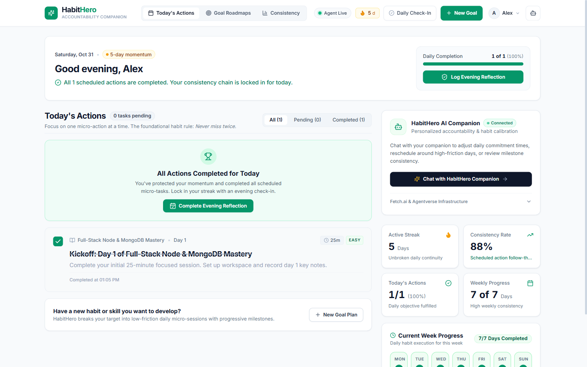
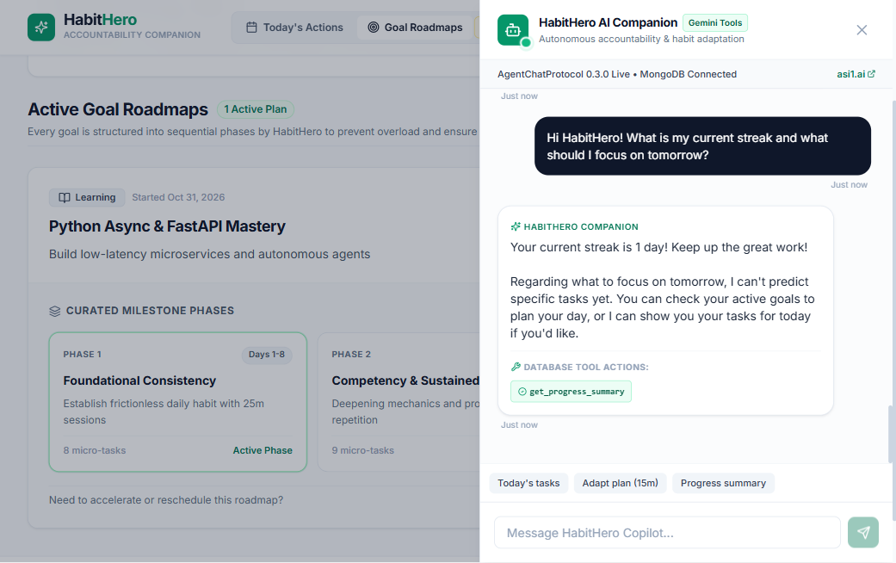
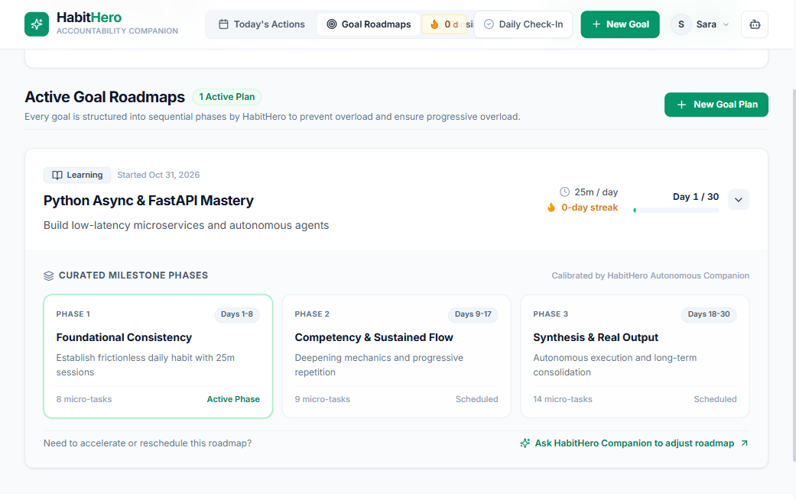
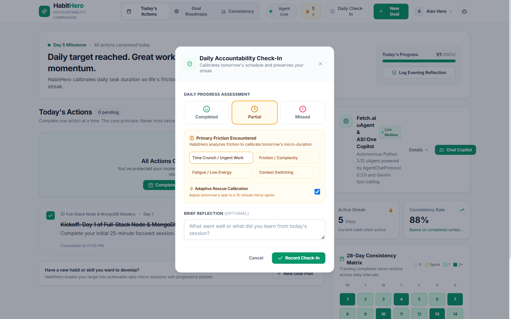
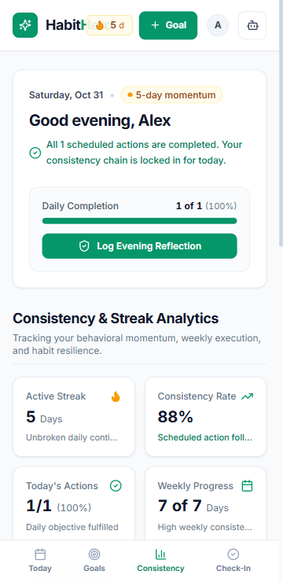
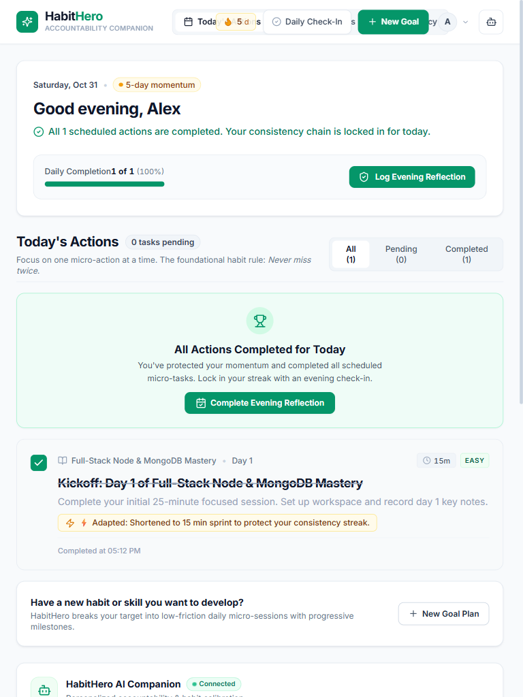
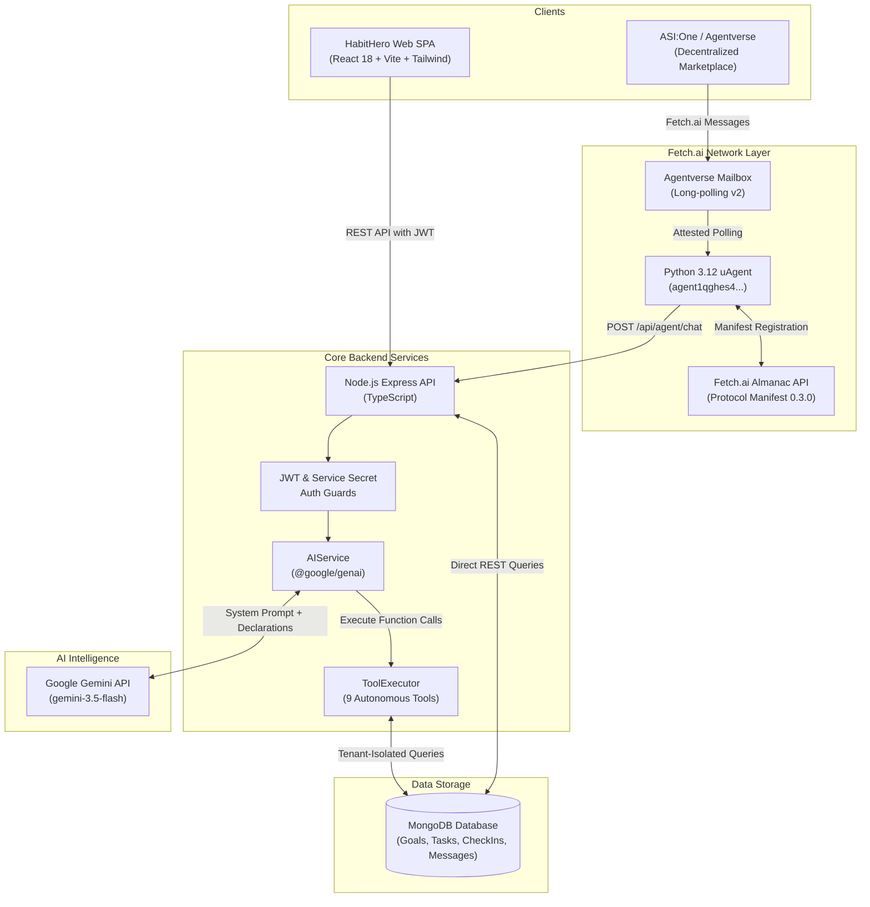

<div align="center">

# ⚡ HabitHero
### *Autonomous AI Accountability Companion — Built on Fetch.ai & Google Gemini*

[](https://opensource.org/licenses/MIT)
[](https://www.typescriptlang.org/)
[](https://reactjs.org/)
[](https://nodejs.org/)
[](https://fetch.ai/)
[](https://ai.google.dev/)
[](https://www.mongodb.com/)
[](https://tailwindcss.com/)
[](https://github.com/manish23092003/habithero-agent)

**Don't just set goals. Actually achieve them.**

HabitHero turns ambitious personal development goals into micro-sprints, tracks bulletproof streaks, dynamically scales commitments down when life gets busy, and connects autonomously to decentralized agent networks via **Fetch.ai uAgents** and **ASI:One**.

[Key Features](#-key-features) • [Real Screenshots](#-application-screenshots) • [Architecture](#-system-architecture) • [Fetch.ai Integration](#-fetchai-agent-integration) • [Quickstart](#-quickstart-guide) • [API Reference](#-api-endpoints-reference)

---

</div>

## 💡 The Problem: Why Traditional Habit Trackers Fail

Most habit trackers act as passive checklists. They track failures without offering solutions:
1. **The "All-or-Nothing" Trap**: Missing one 45-minute study session breaks momentum, triggering guilt and abandonment.
2. **Fixed, Rigid Plans**: Life is volatile. Fixed schedules cannot adapt when emergencies, exams, or fatigue strike.
3. **Passive Accountability**: Checking a red "X" provides zero active guidance or personalized recovery steps.
4. **Isolated Silos**: Traditional habit apps live exclusively within proprietary walled gardens without agent interoperability.

---

## ✨ The Solution: What Makes HabitHero Different

HabitHero is an **autonomous accountability partner** that works across modern web dashboards and decentralized conversational agents:

* **🎯 Natural Language Goal Decomposition**: Tell HabitHero *"I want to master Java in 21 days"*, and Gemini decomposes the goal into phased micro-actions.
* **⚡ Adaptive Sprint Planning**: Having an exhausting day? HabitHero's AI automatically scales today's 45-minute task into a 15-minute micro-sprint so your streak never dies.
* **🤖 Autonomous Fetch.ai Companion**: Discover and talk to HabitHero directly on **ASI:One** via the Fetch.ai `AgentChatProtocol` v0.3.0.
* **📊 Multi-Tenant Cloud Persistence**: Every check-in, task completion, and conversation is strictly isolated and persisted to MongoDB.

---

## 📸 Application Screenshots

> All screenshots captured from the live, production-grade responsive application.

### Desktop Dashboard & Streak Overview

*Modern, high-hierarchy productivity dashboard showing active goals, current streaks, today's action feed, and weekly consistency metrics.*

---

### AI Companion Drawer & Live Natural Language Reasoning

*Embedded conversational AI drawer with autonomous tool execution for goal updates, task retrieval, and real-time encouragement.*

---

### Phased Goal Roadmaps & Adaptive Sprint Modals
<p align="center">
  
  
</p>
*Left: Phased breakdown of active goals with completion status. Right: Evening reflection and adaptive planning modal.*

---

### Mobile & Tablet Responsiveness
<p align="center">
  
  
</p>
*Designed with responsive breakpoints supporting mobile (360px–430px), tablet (768px), and ultra-wide displays.*

---

## 🏗️ System Architecture

HabitHero is built on a decoupled, multi-service architecture coordinating frontend interfaces, Node.js orchestration, Google Gemini reasoning, and decentralized Fetch.ai protocols:



---

## 🌐 Fetch.ai Agent Integration

HabitHero implements the official **Fetch.ai `AgentChatProtocol` (version 0.3.0)** to provide a discoverable, conversational agent on the decentralized Fetch.ai network:

* **Deterministic Agent Address**: `agent1qghes4q3u28wc48zeateraflnf3uadm3ygam56lwh2m5elxm407256zqkkw`
* **Agentverse Mailbox**: Utilizes attested long-polling to retrieve incoming messages from Agentverse with HTTP 200 responses.
* **Almanac API Discovery**: Manifest and chat capabilities are registered on the Almanac contract for instant discovery in **ASI:One**.
* **Zero-Mock Message Lifecycle**:
  ```text
  ASI:One User -> ChatMessage -> Agentverse -> HabitHero uAgent
  HabitHero uAgent -> Instant ChatAcknowledgement -> User
  HabitHero uAgent -> POST /api/agent/chat (with x-agent-secret) -> Node.js
  Node.js -> Gemini Function Calling -> MongoDB Persistence
  Node.js -> Formatted Response -> HabitHero uAgent -> ChatMessage Reply -> User
  ```

---

## 🧠 Gemini AI Autonomous Tool Engine

HabitHero provides Google Gemini with **9 custom tool declarations**, enabling the AI to query, create, and adapt database records autonomously:

| Tool | Parameters | Description |
|---|---|---|
| `create_goal` | `title`, `category`, `dailyCommitmentMinutes`, `targetDays` | Creates a goal in MongoDB and automatically schedules the kickoff Day 1 task. |
| `get_today_tasks` | *(none)* | Queries all active tasks assigned to the user for the current date. |
| `complete_task` | `taskId` | Marks task completed, timestamps completion, and increments the goal streak. |
| `create_tasks` | `goalId`, `tasks: [{ title, durationMinutes, dayNumber }]` | Appends milestone or challenge tasks to a goal plan. |
| `adapt_task` | `taskId`, `newDurationMinutes`, `adaptationNote` | Scales a task down to a 5–15 min micro-sprint when life gets busy. |
| `update_goal` | `goalId`, `dailyCommitmentMinutes`, `adaptationNotice` | Modifies the target daily commitment and logs adaptation reason. |
| `adapt_habit_plan` | `goalId`, `reason`, `targetMinutes` | Bulk-adapts upcoming pending tasks to maintain consistency without burnout. |
| `record_checkin` | `status`, `missedReason`, `reflection`, `adaptTomorrow` | Persists daily reflection and flags plan adjustments for tomorrow. |
| `get_progress_summary` | *(none)* | Calculates overall consistency rate, current streak, and completion statistics. |

---

## 🛠️ Technology Stack

| Layer | Technologies | Purpose |
|---|---|---|
| **Frontend** | React 18, TypeScript, Vite, Tailwind CSS, Lucide Icons, Canvas Confetti | Responsive SaaS user interface, streak visualization, and interactive chat drawer |
| **Backend** | Node.js, Express.js, TypeScript, Mongoose, Zod, JWT, bcryptjs | RESTful APIs, multi-tenant authentication, and service-to-service security |
| **Decentralized Agent** | Python 3.12, Fetch.ai `uagents`, `uagents-core`, `aiohttp`, `pydantic` | Autonomous agent runtime, `AgentChatProtocol` 0.3.0, and Agentverse Mailbox |
| **Artificial Intelligence** | Google Gemini (`gemini-3.5-flash`), `@google/genai` | Autonomous natural language understanding, function calling, and personalized planning |
| **Database** | MongoDB (with automatic `mongodb-memory-server` local fallback) | Document storage for users, goals, daily tasks, check-in logs, and conversations |

---

## 📁 Repository Directory Structure

```text
hero-habit/
├── backend/                        # Node.js & Express REST API Server
│   ├── src/
│   │   ├── ai/                     # Gemini AI service, tool declarations, tool executor
│   │   ├── config/                 # MongoDB connection & in-memory database fallback
│   │   ├── controllers/            # Auth, Goal, Task, CheckIn, Chat & Agent controllers
│   │   ├── middleware/             # JWT authentication & route security guards
│   │   ├── models/                 # Mongoose schemas (User, Goal, Task, CheckIn, Message)
│   │   ├── routes/                 # Express route definitions
│   │   ├── services/               # Goal & Task business logic services
│   │   ├── app.ts                  # Express application setup & middleware
│   │   └── server.ts               # HTTP server entry point
│   ├── tests/                      # Integration test suites (api.test.ts, agent.test.ts)
│   └── package.json
│
├── frontend/                       # React 18 TypeScript Single-Page Application
│   ├── src/
│   │   ├── components/             # 11 production UI components (Modals, Feed, Drawer, Banner)
│   │   ├── data/                   # Initial preview mock data for demo mode
│   │   ├── services/               # Axios/Fetch API client with JWT lifecycle handling
│   │   ├── types/                  # TypeScript interfaces and domain models
│   │   ├── App.tsx                 # Master state coordinator & view router
│   │   ├── index.css               # Tailwind CSS theme & typography styles
│   │   └── main.tsx                # React DOM root entry point
│   ├── vite.config.ts
│   └── package.json
│
├── habithero-agent/                # Fetch.ai Autonomous Python uAgent
│   ├── tests/                      # Pytest suite for ChatProtocol and agent logic
│   ├── agent.py                    # Main uAgent setup, ChatProtocol handlers, Almanac registration
│   ├── backend_client.py           # Async HTTP client forwarding messages to Node.js backend
│   ├── config.py                   # Environment loader & configuration models
│   └── requirements.txt            # Python dependencies (uagents 0.26.1)
│
├── docs/                           # Technical documentation & real UI assets
│   ├── screenshots/                # Real production application screenshots
│   ├── architecture.md             # In-depth architectural specification & sequence diagrams
│   └── development.md              # Local setup, API reference & multi-service debugging
│
├── .env.example                    # Root environment variable template
├── .gitignore                      # Git exclusion rules (strictly excludes all .env & secrets)
├── CHANGELOG.md                    # Release history and milestone tracking
├── CONTRIBUTING.md                 # Contribution guidelines & Conventional Commits standards
├── LICENSE                         # Open-source MIT License
├── package.json                    # Monorepo coordinate scripts
├── README.md                       # Master repository documentation
└── SECURITY.md                     # Security policy, reporting guidelines & data isolation
```

---

## 🚀 Quickstart Guide

### 1. Clone the Repository
```bash
git clone https://github.com/manish23092003/habithero-agent.git
cd habithero-agent
```

### 2. Configure Environment Variables
Copy each example environment file:
```bash
# Backend configuration
cp backend/.env.example backend/.env

# Fetch.ai agent configuration
cp habithero-agent/.env.example habithero-agent/.env
```
*(Add your `GEMINI_API_KEY` in `backend/.env`)*.

### 3. Start Backend API Server
```bash
cd backend
npm install
npm run dev
```
*Backend runs on `http://localhost:5000` (auto-connects to MongoDB or falls back to built-in in-memory instance).*

### 4. Start Frontend Web Application
```bash
cd ../frontend
npm install
npm run dev
```
*Web dashboard opens at `http://localhost:5173`.*

### 5. Start Fetch.ai uAgent Daemon
```bash
cd ../habithero-agent
python -m venv .venv
source .venv/bin/activate       # macOS / Linux
# .venv\Scripts\activate        # Windows
pip install -r requirements.txt
python agent.py
```
*uAgent connects to Agentverse, registers on Almanac API, and starts long-polling for ASI:One messages.*

---

## 🧪 Testing & Verification

HabitHero includes comprehensive integration and unit test suites across all services:

```bash
# 1. Run all backend integration tests (63 tests)
cd backend
npm test

# 2. Run Python uAgent test suite (10 tests)
cd ../habithero-agent
pytest tests/test_agent.py

# 3. Verify frontend production TypeScript compilation
cd ../frontend
npm run build
```

---

## 📡 API Endpoints Reference

| Method | Endpoint | Description | Auth Required |
|---|---|---|---|
| `POST` | `/api/auth/register` | Register a new user profile | No |
| `POST` | `/api/auth/login` | Authenticate user and issue JWT | No |
| `GET` | `/api/auth/me` | Fetch current user profile | Yes (Bearer JWT) |
| `GET` | `/api/goals` | List all goals for authenticated user | Yes (Bearer JWT) |
| `POST` | `/api/goals` | Create a new goal and kickoff task | Yes (Bearer JWT) |
| `GET` | `/api/tasks/today` | Fetch today's assigned tasks | Yes (Bearer JWT) |
| `PATCH` | `/api/tasks/:id/complete`| Toggle task completion & streak | Yes (Bearer JWT) |
| `POST` | `/api/checkins` | Submit daily reflection check-in | Yes (Bearer JWT) |
| `POST` | `/api/chat/message` | Send natural language prompt to Gemini | Yes (Bearer JWT) |
| `POST` | `/api/agent/chat` | Internal endpoint for Fetch.ai uAgent | Yes (`x-agent-secret`) |

---

## 🔐 Security & Privacy

* **Strict Data Isolation**: All database queries enforce `userId: req.user.id`. Foreign users cannot view or manipulate another account's goals or tasks.
* **Zero Credential Exposure**: `.gitignore` strictly excludes `.env`, `*.agent.key`, `*.seed`, and database directories. All `.env.example` templates contain only safe placeholders.
* **Service Secret Protection**: Internal communication between the Python uAgent and Node.js backend requires `x-agent-secret` header verification.

---

## 🗺️ Roadmap & Future Enhancements

- [x] Full-Stack responsive SaaS application (React 18 + Node.js + MongoDB)
- [x] Gemini AI autonomous tool calling engine (9 custom tools)
- [x] Fetch.ai `AgentChatProtocol` 0.3.0 & Agentverse Mailbox integration
- [x] Dual-entry multi-tenant data isolation architecture
- [ ] Automated push notifications & Telegram companion bridge
- [ ] Calendar sync (Google Calendar / Outlook integration)
- [ ] Voice-based daily check-ins via Fetch.ai audio stream protocols

---

## 🤝 Contributing

Contributions are welcome! Please read [CONTRIBUTING.md](CONTRIBUTING.md) for details on code style, commit conventions, and pull request procedures.

---

## 📄 License

This project is open-source and licensed under the **[MIT License](LICENSE)**.

---

## 👨‍💻 Author

**Manish Soni**
* **GitHub**: [@manish23092003](https://github.com/manish23092003)
* **Project**: HabitHero — AI Accountability Companion
* **Event**: STRANGER BUILDS Hackathon (Fetch.ai Track)
