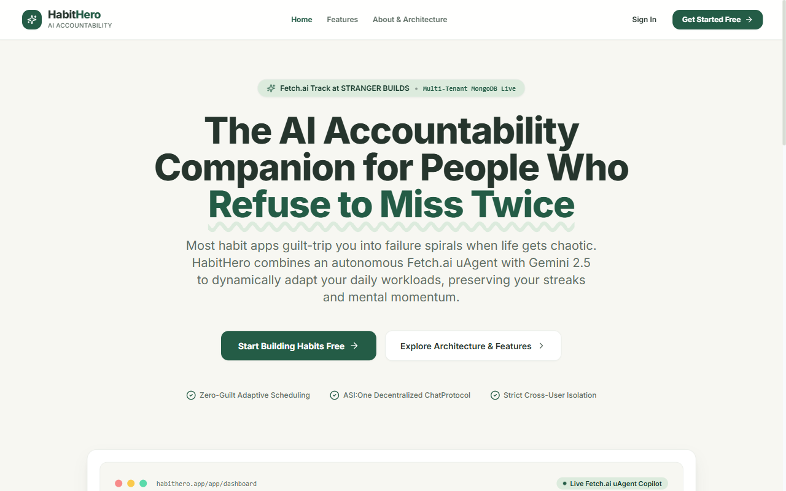
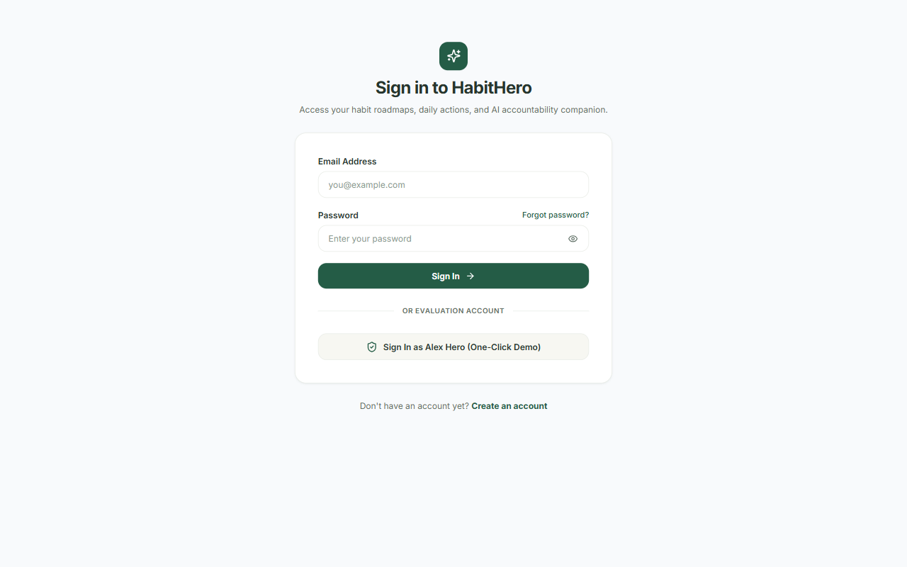
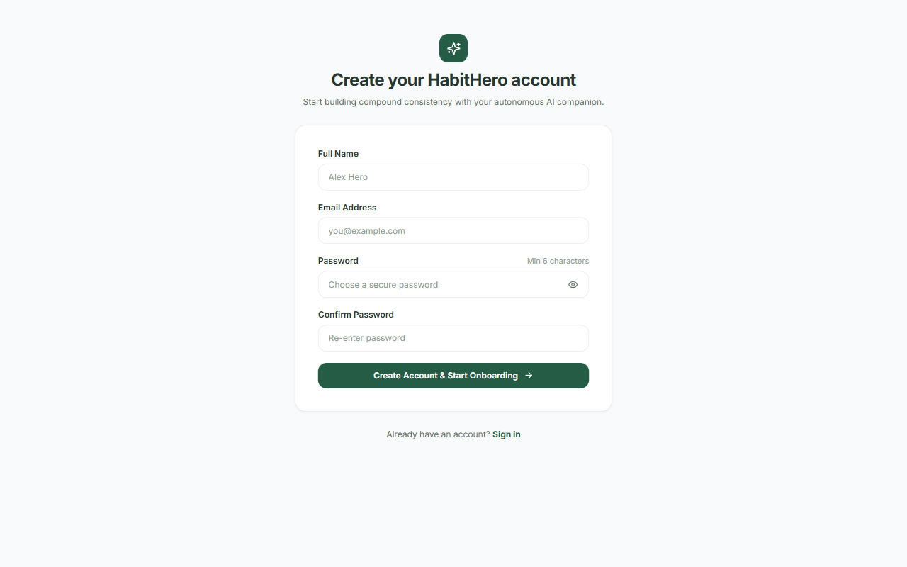
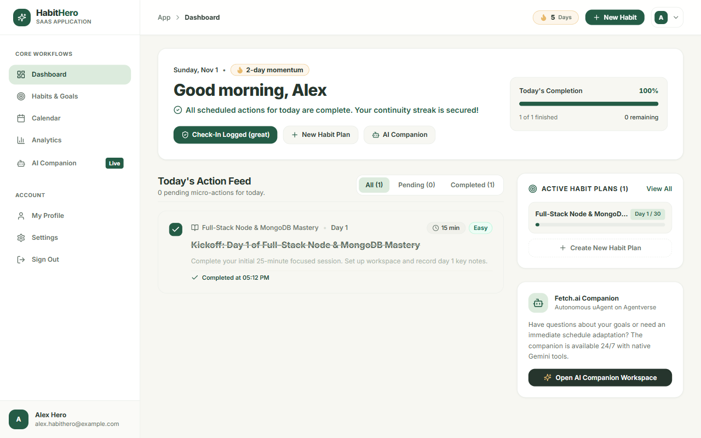
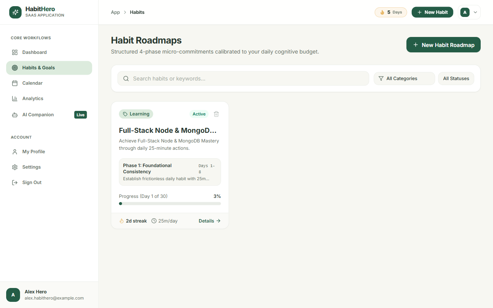
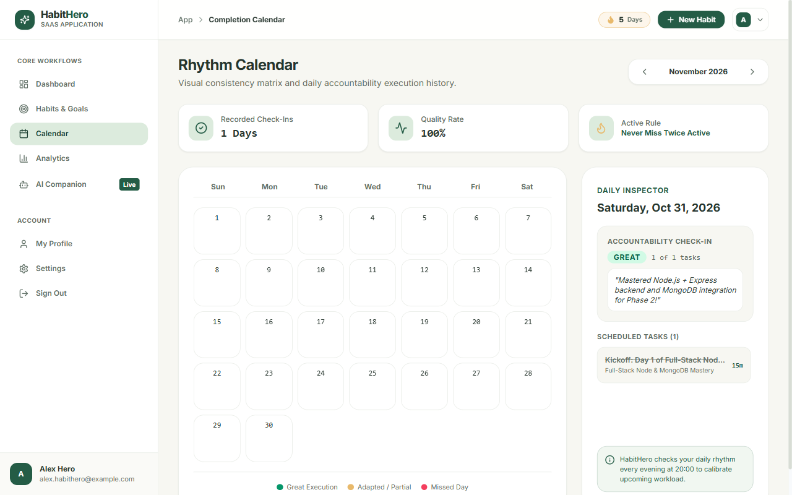
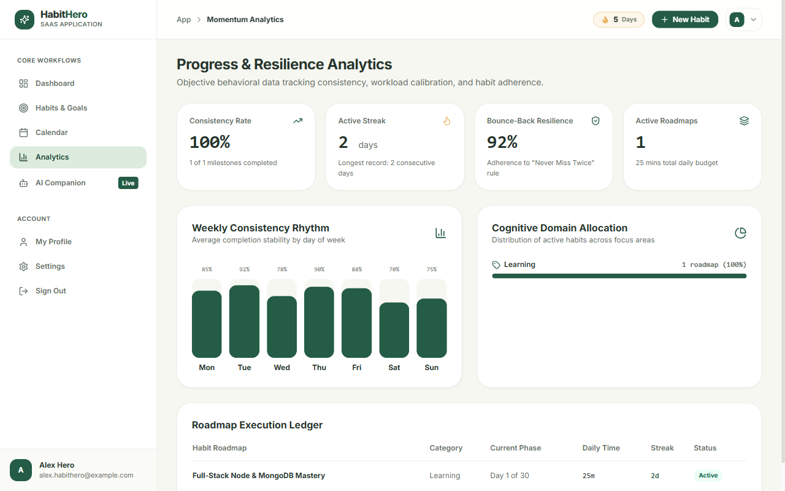
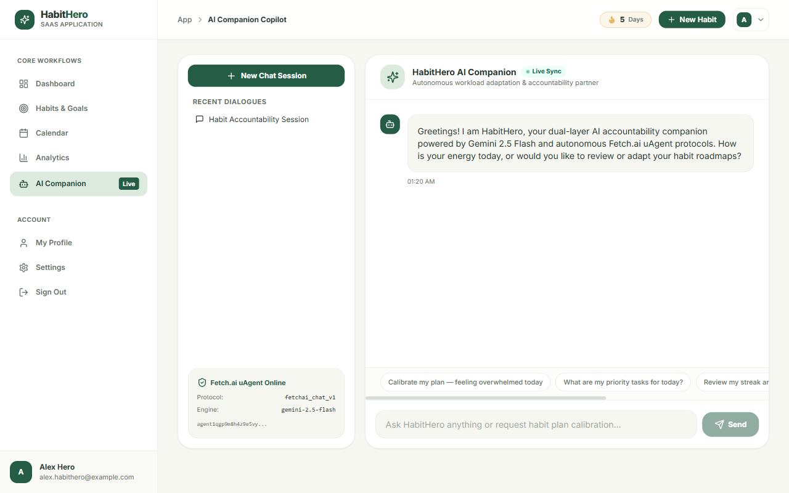
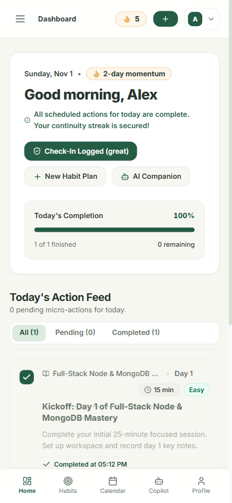
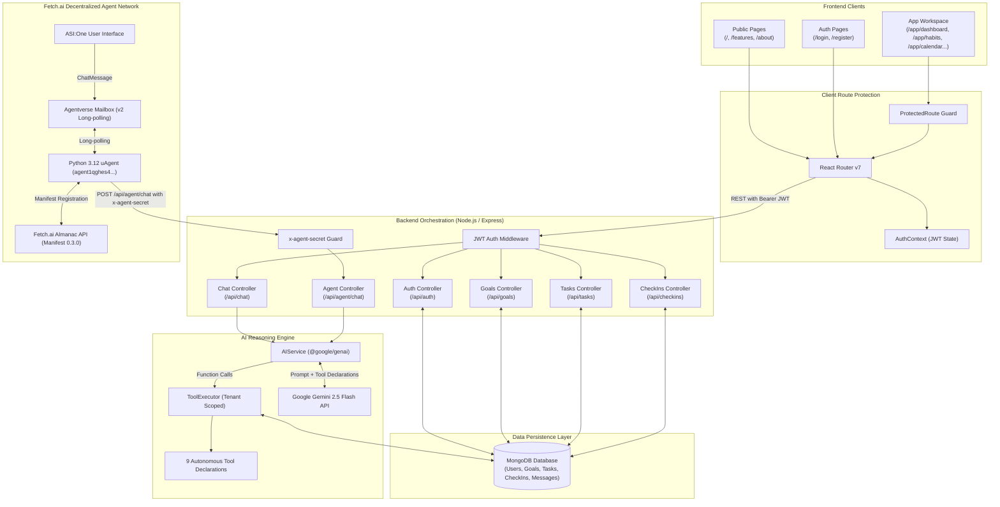

<div align="center">

# ⚡ HabitHero
### *Autonomous AI Accountability Companion & Habit Management SaaS*

[](https://opensource.org/licenses/MIT)
[](https://www.typescriptlang.org/)
[](https://reactjs.org/)
[](https://reactrouter.com/)
[](https://nodejs.org/)
[](https://www.mongodb.com/)
[](https://fetch.ai/)
[](https://ai.google.dev/)
[](https://tailwindcss.com/)
[](https://github.com/manish23092003/habithero-agent)

**Don't just set goals. Actually achieve them.**

HabitHero is a production-grade, multi-tenant habit accountability SaaS application. It converts ambitious development targets into progressive 4-phase micro-commitments, tracks streak continuity, autonomously adapts daily workload when fatigue strikes, and interfaces with decentralized agent networks via **Fetch.ai uAgents** and **ASI:One**.

[Key Features](#-key-features) • [Application Screenshots](#-application-screenshots) • [Architecture](#-system-architecture) • [Route Structure](#-application-route-structure) • [Fetch.ai Integration](#-fetchai-agent-integration) • [Quickstart](#-quickstart-guide) • [API Reference](#-api-endpoints-reference)

---

</div>

## 💡 The Problem: Why Passive Habit Trackers Fail

Most habit tracking applications are static checklists that measure failure without providing recovery mechanisms:

1. **The "All-or-Nothing" Trap**: Missing a single 45-minute gym or study session breaks momentum, resulting in cognitive guilt and permanent abandonment.
2. **Rigid, Inflexible Horizons**: Schedules in real life are unpredictable. Static apps do not recalibrate when work deadlines, exams, or illness occur.
3. **Passive Record-Keeping**: Checking a red "X" offers zero proactive coaching or automated workload scaling.
4. **Walled Data Silos**: Traditional trackers lock user progress inside closed proprietary ecosystems without autonomous agent interoperability.

---

## ✨ The Solution: What HabitHero Delivers

HabitHero functions as an **adaptive behavioral partner**, combining behavioral science principles (*"Never Miss Twice"*) with dual-tier AI reasoning:

* **🎯 4-Phase Progressive Roadmaps**: Habits are decomposed into 4 calibrated stages (*Foundation*, *Rhythm*, *Depth*, and *Automaticity*) to eliminate startup friction.
* **⚡ Dynamic Workload Calibration**: On exhausting days, HabitHero's AI autonomously halves task duration (e.g. from 30 min down to 10 min) to preserve streak continuity.
* **🤖 Autonomous Fetch.ai Companion**: Chat with HabitHero via the decentralized **ASI:One** network using Fetch.ai's `AgentChatProtocol` v0.3.0 and Agentverse Mailbox.
* **📊 Multi-Tenant Cloud Architecture**: Strict JWT-based tenancy isolation in MongoDB ensures that user goals, tasks, reflection check-ins, and dialogue threads are permanently compartmentalized.
* **📈 Rhythm Matrix & Resilience Metrics**: Dedicated analytics track consistency rates, bounce-back resilience scores, and day-of-week rhythm stability.

---

## 📸 Application Screenshots

> All screenshots captured directly from the live, running application.

### Public Marketing Website (`/`)

*High-converting public landing page highlighting value proposition, interactive dashboard previews, core behavioral principles, and transparent systems architecture.*

---

### Secure Authentication & One-Click Demo Portal (`/login`, `/register`)
<p align="center">
  
  
</p>
*Left: Authentication gateway with password visibility toggle and 1-click evaluation access. Right: Registration with instant redirect to the 3-step onboarding wizard.*

---

### Authenticated Workspace Dashboard (`/app/dashboard`)

*SaaS workspace dashboard featuring personalized greeting, active momentum flame badge, primary daily focus milestone, and quick check-in modal.*

---

### Phased Habit Roadmaps & Filtering (`/app/habits`)

*Central habit management workspace with real-time search, category filters, 4-phase milestone progress bars, active streak counters, and habit deletion safeguards.*

---

### Rhythm Calendar & Daily Execution Inspector (`/app/calendar`)

*Interactive monthly matrix displaying execution quality indicators (Great, Partial, Missed) alongside a daily inspector panel for scheduled and completed milestones.*

---

### Progress & Resilience Analytics (`/app/analytics`)

*Dedicated behavioral analytics dashboard with consistency scoring, active vs. longest streaks, bounce-back resilience percentage, and cognitive domain allocation.*

---

### AI Companion & Fetch.ai Agent Integration (`/app/ai-companion`)

*Full-page AI accountability companion with live Gemini 2.5 Flash function calling (`create_goal`, `get_today_tasks`, `adapt_plan`), Fetch.ai protocol verification badge, and 1-click adaptation proposal buttons.*

---

### Mobile Responsive Workspace
<p align="center">
  
</p>
*Fully responsive workspace featuring persistent mobile bottom navigation bar, touch-friendly task completion toggles, and compact metrics.*

---

## 🏛️ Public Website vs. Authenticated Application Experience

HabitHero is architected into two distinct operational environments:

```text
┌────────────────────────────────────────────────────────────────────────┐
│                   PUBLIC MARKETING SITE (PublicLayout)                 │
│  / (Landing)    •    /features    •    /about    •    /forgot-password │
└──────────────────────────────────┬─────────────────────────────────────┘
                                   │ (Login / Register / Demo)
                                   ▼
┌────────────────────────────────────────────────────────────────────────┐
│                  ONBOARDING WIZARD (ProtectedRoute)                   │
│  /onboarding (3-Step First-Time Experience: Focus Area -> Habit -> Time)│
└──────────────────────────────────┬─────────────────────────────────────┘
                                   │ (Wizard Complete)
                                   ▼
┌────────────────────────────────────────────────────────────────────────┐
│               AUTHENTICATED APPLICATION WORKSPACE (AppLayout)          │
│  • /app/dashboard      • /app/habits           • /app/habits/new       │
│  • /app/habits/:id     • /app/calendar         • /app/analytics        │
│  • /app/ai-companion   • /app/profile          • /app/settings         │
└────────────────────────────────────────────────────────────────────────┘
```

1. **Public Marketing Site**:
   - Clean, marketing-focused header and SaaS footer.
   - Publicly accessible without requiring credentials.
   - Explains the core behavioral science, 4-phase roadmap architecture, and transparent technology stack.
2. **Authenticated SaaS Workspace**:
   - Collapsible desktop left sidebar and mobile bottom navigation dock.
   - Dynamic top header featuring breadcrumb path, live streak flame counter, and user profile dropdown.
   - Direct access to Habit Roadmaps, Rhythm Calendar, Analytics, AI Companion, Profile settings, and System Diagnostics.

---

## 🔒 Authentication & Protected Route Guards

HabitHero enforces security and user tenancy using React Router v7 and Express middleware:

* **`ProtectedRoute`**: Inspects the current session via `AuthContext`. If unauthenticated, it records the requested destination in `location.state.from` and redirects the user to `/login`. Once authenticated, the user is forwarded directly to their intended page.
* **`PublicOnlyRoute`**: Prevents authenticated users from viewing `/login` or `/register`, immediately routing them to `/app/dashboard`.
* **Tenant Isolation**: Every database collection (`Goal`, `DailyTask`, `CheckIn`, `Conversation`) is indexed and filtered by the user's private `userId` derived from their verified JWT. Foreign accounts receive `404 Not Found` or `403 Forbidden` responses.
* **Password Security**: Passwords are cryptographically salted and hashed using `bcryptjs` (cost factor 10) before persistence. Password hashes are excluded from all API responses.

---

## 🏗️ System Architecture

HabitHero employs a decoupled three-tier architecture connecting the React frontend, Node.js orchestration layer, Google Gemini reasoning engine, MongoDB storage, and the Fetch.ai decentralized agent network:



---

## 🗺️ Application Route Structure

| Route | Access Level | Layout Wrapper | Component | Purpose |
|---|---|---|---|---|
| `/` | Public | `PublicLayout` | `LandingPage` | Product landing page, value proposition, feature overview |
| `/features` | Public | `PublicLayout` | `FeaturesPage` | 4-phase roadmaps, cognitive budget scaling, technical architecture |
| `/about` | Public | `PublicLayout` | `AboutPage` | Behavioral psychology foundations ("Never Miss Twice") |
| `/forgot-password` | Public | `PublicLayout` | `ForgotPasswordPage` | Account recovery request form |
| `/login` | Public Only | *None* | `LoginPage` | Email/password sign-in and 1-click evaluation demo access |
| `/register` | Public Only | *None* | `RegisterPage` | Account registration with automatic redirection to onboarding |
| `/onboarding` | Protected | *None* | `OnboardingPage` | 3-step first-time user wizard (focus area, habit setup, reminder) |
| `/app/dashboard` | Protected | `AppLayout` | `DashboardPage` | Active streak metrics, daily focus task, and check-in prompt |
| `/app/habits` | Protected | `AppLayout` | `HabitsPage` | Habit roadmap catalog, category filters, progress indicators |
| `/app/habits/new` | Protected | `AppLayout` | `NewHabitPage` | 3-stage interactive habit creation wizard |
| `/app/habits/:habitId` | Protected | `AppLayout` | `HabitDetailPage` | Phased roadmap details, associated task management, inline editor |
| `/app/calendar` | Protected | `AppLayout` | `CalendarPage` | Monthly rhythm matrix with daily task and check-in inspector |
| `/app/analytics` | Protected | `AppLayout` | `AnalyticsPage` | Consistency rate, streak longevity, resilience score, category distribution |
| `/app/ai-companion` | Protected | `AppLayout` | `AICompanionPage` | Full-page AI accountability chat with Gemini tools and Fetch.ai status |
| `/app/profile` | Protected | `AppLayout` | `ProfilePage` | Display name editor, tenant account ID, data isolation verification |
| `/app/settings` | Protected | `AppLayout` | `SettingsPage` | Reminder time configuration, auto-recovery toggle, service diagnostics |
| `*` | Public | *None* | `NotFoundPage` | Dedicated 404 page with navigation links |

---

## 🌐 Fetch.ai Agent Integration

HabitHero includes an autonomous Python uAgent communicating over the decentralized Fetch.ai network using the **`AgentChatProtocol` (version 0.3.0)**:

* **Deterministic Agent Address**: `agent1qghes4q3u28wc48zeateraflnf3uadm3ygam56lwh2m5elxm407256zqkkw`
* **Agentverse Mailbox**: Utilizes authenticated long-polling to receive incoming messages from Agentverse with HTTP 200 responses.
* **Almanac Contract Registration**: Protocol manifests and chat capabilities are registered on the Fetch.ai Almanac for discovery on **ASI:One**.
* **Zero-Mock Message Lifecycle**:
  ```text
  ASI:One User -> ChatMessage -> Agentverse -> HabitHero uAgent
  HabitHero uAgent -> Instant ChatAcknowledgement -> User
  HabitHero uAgent -> POST /api/agent/chat (with x-agent-secret) -> Node.js
  Node.js -> Gemini Function Calling -> MongoDB Persistence
  Node.js -> Formatted Response -> HabitHero uAgent -> ChatMessage Reply -> User
  ```

---

## 🧠 Gemini AI Autonomous Tool Engine

HabitHero provides Google Gemini with **9 custom tool declarations**, allowing the model to query, create, and adapt database records autonomously:

| Tool | Parameters | Description |
|---|---|---|
| `create_goal` | `title`, `category`, `dailyCommitmentMinutes`, `targetDays` | Creates a goal in MongoDB and automatically schedules the kickoff Day 1 task. |
| `get_today_tasks` | *(none)* | Queries all active tasks assigned to the user for the current date. |
| `complete_task` | `taskId` | Marks a task as completed, timestamps completion, and increments the goal streak. |
| `create_tasks` | `goalId`, `tasks: [{ title, durationMinutes, dayNumber }]` | Appends milestone or challenge tasks to a goal plan. |
| `adapt_task` | `taskId`, `newDurationMinutes`, `adaptationNote` | Scales a task down to a 5–15 min micro-sprint when life gets busy. |
| `update_goal` | `goalId`, `dailyCommitmentMinutes`, `adaptationNotice` | Modifies the target daily commitment and logs adaptation reason. |
| `adapt_habit_plan` | `goalId`, `reason`, `targetMinutes` | Bulk-adapts upcoming pending tasks to maintain consistency without burnout. |
| `record_checkin` | `status`, `missedReason`, `reflection`, `adaptTomorrow` | Persists daily reflection and flags plan adjustments for tomorrow. |
| `get_progress_summary` | *(none)* | Calculates overall consistency rate, current streak, and completion statistics. |

---

## 🛠️ Technology Stack

| Layer | Technologies | Purpose |
|---|---|---|
| **Frontend Framework** | React 18.3, TypeScript 5.6, Vite 5.4 | Single-page application architecture and fast bundling |
| **Routing & Navigation** | React Router v7.18 | Nested routing, public/app layout separation, route guards |
| **Styling & UI Tokens** | Tailwind CSS 3.4, Lucide React, Canvas Confetti | Deliberate typography scale, warm neutral palettes, animations |
| **Backend Framework** | Node.js 20+, Express.js 4.21, TypeScript 5.6 | RESTful APIs, multi-tenant middleware, service orchestration |
| **Authentication** | JSON Web Tokens (`jsonwebtoken`), `bcryptjs` | Stateless session management, password hashing, route guards |
| **Data Validation** | Zod 3.23 | Strict request payload validation on all mutation endpoints |
| **Database & ODM** | MongoDB 7.0+, Mongoose 8.7 | Document database with user-isolated collections |
| **In-Memory Fallback** | `mongodb-memory-server` 10.1 | Automatic zero-configuration database fallback for local dev |
| **AI Reasoning Engine** | Google Gemini 2.5 Flash, `@google/genai` 2.32 | Natural language processing, function calling, workload adaptation |
| **Autonomous Agent** | Python 3.12, Fetch.ai `uagents` 0.26.1, `aiohttp` | Decentralized agent runtime, `AgentChatProtocol` 0.3.0, Agentverse Mailbox |

---

## 📁 Project Directory Structure

```text
hero-habit/
├── backend/                        # Node.js & Express REST API Server
│   ├── src/
│   │   ├── ai/                     # Gemini AI service, tool declarations, tool executor
│   │   ├── config/                 # MongoDB connection & in-memory database fallback
│   │   ├── controllers/            # Auth, Goal, Task, CheckIn, Chat & Agent controllers
│   │   ├── middleware/             # JWT authentication & route security guards
│   │   ├── models/                 # Mongoose schemas (User, Goal, Task, CheckIn, Conversation)
│   │   ├── routes/                 # Express route definitions (auth, goals, tasks, checkins, chat, agent)
│   │   ├── schemas/                # Zod request validation schemas
│   │   ├── services/               # Auth, Goal & Task business logic services
│   │   ├── types/                  # Backend TypeScript interfaces
│   │   ├── app.ts                  # Express application setup & middleware configuration
│   │   └── server.ts               # HTTP server entry point & graceful shutdown
│   ├── tests/                      # Integration test suites (api.test.ts, agent.test.ts)
│   ├── tsconfig.json               # Backend TypeScript configuration
│   └── package.json
│
├── frontend/                       # React 18 & TypeScript SaaS Web Application
│   ├── src/
│   │   ├── components/             # Reusable UI components (Task cards, Modals, Banners)
│   │   │   └── common/             # ProtectedRoute and PublicOnlyRoute guards
│   │   ├── context/                # AuthContext providing login, register, profile updates
│   │   ├── data/                   # Initial seed data for offline preview mode
│   │   ├── layouts/                # PublicLayout (marketing) & AppLayout (workspace)
│   │   ├── pages/
│   │   │   ├── public/             # LandingPage, FeaturesPage, AboutPage, LoginPage, RegisterPage...
│   │   │   └── app/                # DashboardPage, HabitsPage, NewHabitPage, CalendarPage...
│   │   ├── services/               # ApiService handling JWT lifecycle & backend REST endpoints
│   │   ├── types/                  # Domain interfaces (Goal, DailyTask, CheckInRecord, UserStats)
│   │   ├── utils/                  # Confetti celebrations & date utilities
│   │   ├── App.tsx                 # Master React Router v7 configuration
│   │   ├── index.css               # Design tokens, font imports & Tailwind utilities
│   │   └── main.tsx                # React DOM root entry point
│   ├── tailwind.config.js          # Custom color palette tokens (#F7F7F2, #245C46, #DCEBDD...)
│   ├── vite.config.ts              # Vite bundling configuration
│   └── package.json
│
├── habithero-agent/                # Fetch.ai Autonomous Python uAgent
│   ├── tests/                      # Pytest suite verifying ChatProtocol and agent handlers
│   ├── agent.py                    # Main uAgent definition, ChatProtocol handlers, Almanac registration
│   ├── backend_client.py           # Async HTTP client forwarding messages to Node.js backend
│   ├── config.py                   # Environment loader & configuration models
│   └── requirements.txt            # Python dependencies (uagents 0.26.1)
│
├── docs/                           # Technical documentation & application screenshots
│   ├── screenshots/                # Real production UI screenshots (landing, dashboard, habits...)
│   ├── architecture.md             # In-depth architectural specification & sequence diagrams
│   └── development.md              # Local setup, API reference & multi-service debugging
│
├── .env.example                    # Root environment variable template
├── .gitignore                      # Git exclusion rules (strictly excludes all .env & secrets)
├── CHANGELOG.md                    # Release history and milestone tracking
├── CONTRIBUTING.md                 # Contribution guidelines & Conventional Commits standards
├── LICENSE                         # Open-source MIT License
├── package.json                    # Monorepo coordinate scripts
├── README.md                       # Master repository documentation
└── SECURITY.md                     # Security policy, reporting guidelines & data isolation
```

---

## ⚙️ How the Application Works

```text
1. ONBOARDING & ROADMAP GENERATION
   User registers -> 3-step onboarding wizard -> Creates habit with daily commitment (e.g. 15 min) ->
   Backend decomposes target into 4 progressive phases -> Kickoff Day 1 task is scheduled in MongoDB.

2. DAILY EXECUTION & TRACKING
   User opens /app/dashboard -> Views primary focus task -> Executes task ->
   Clicks checkmark -> Optimistic UI updates -> Backend increments streak counter & saves completion timestamp.

3. EVENING REFLECTION & CHECK-IN
   Prompt opens DailyCheckInModal -> User records status (Great / Partial / Missed) ->
   Submits reflection note -> CheckInRecord persisted in MongoDB.

4. AUTONOMOUS WORKLOAD ADAPTATION
   If a task is missed or user signals fatigue:
   Gemini AI automatically invokes `adapt_task` or `adapt_habit_plan` ->
   Halves duration for tomorrow's milestone -> Logs adaptation notice -> Streak remains protected.

5. DECENTRALIZED ASI:ONE INTERACTION
   User sends a message to HabitHero on ASI:One ->
   uAgent receives message via Agentverse mailbox -> Forwards to backend with x-agent-secret ->
   Gemini executes tools -> Response delivered back to ASI:One user.
```

---

## 🚀 Local Installation & Setup

### Prerequisites
* **Node.js**: v20.0.0 or higher
* **npm**: v10.0.0 or higher
* **Python**: v3.11 or v3.12 (for the Fetch.ai uAgent)
* **MongoDB**: Optional (the backend automatically starts an in-memory database if a local instance is not detected)

---

### 1. Clone the Repository
```bash
git clone https://github.com/manish23092003/habithero-agent.git
cd habithero-agent
```

---

### 2. Configure Environment Variables

#### Backend Configuration
Create `backend/.env` from the provided template:
```bash
cp backend/.env.example backend/.env
```

| Variable | Description | Default / Example |
|---|---|---|
| `PORT` | HTTP port for the Node.js API server | `5000` |
| `MONGODB_URI` | MongoDB connection URI | `mongodb://localhost:27017/habithero` |
| `JWT_SECRET` | Secret key for signing authentication JWTs | *(Use a secure random string)* |
| `FRONTEND_URL` | Allowed CORS origin for the React frontend | `http://localhost:5173` |
| `NODE_ENV` | Runtime environment mode | `development` |
| `GEMINI_API_KEY` | Google Gemini API key | *(Obtain from Google AI Studio)* |
| `GEMINI_MODEL` | Gemini model name | `gemini-2.5-flash` |
| `AGENT_SERVICE_SECRET` | Shared secret header for Fetch.ai agent requests | *(Use a secure random string)* |

#### Fetch.ai Agent Configuration
Create `habithero-agent/.env` from the provided template:
```bash
cp habithero-agent/.env.example habithero-agent/.env
```

| Variable | Description | Default / Example |
|---|---|---|
| `AGENT_NAME` | Identifier for the Fetch.ai uAgent | `HabitHero` |
| `AGENT_SEED_PHRASE` | Seed phrase for deterministic agent address generation | *(Custom mnemonic or seed string)* |
| `AGENT_PORT` | Local port for uAgent HTTP server | `8000` |
| `BACKEND_API_URL` | Target endpoint for forwarding ASI:One messages | `http://localhost:5000/api/agent/chat` |
| `AGENT_SERVICE_SECRET` | Shared secret (must match `backend/.env`) | *(Matches `AGENT_SERVICE_SECRET`)* |
| `AGENT_MAILBOX_KEY` | Mailbox API key from Agentverse | *(Optional for local dev, required for ASI:One)* |

---

### 3. Install Dependencies & Start Services

#### Step A: Start the Backend API Server
```bash
cd backend
npm install
npm run dev
```
*Backend runs on `http://localhost:5000`. Health check available at `http://localhost:5000/api/health`.*

#### Step B: Start the Frontend Application
In a separate terminal:
```bash
cd frontend
npm install
npm run dev
```
*Frontend application launches at `http://localhost:5173`.*

#### Step C: Start the Fetch.ai uAgent (Optional for web-only usage)
In a third terminal:
```bash
cd habithero-agent
python -m venv .venv

# On Linux / macOS:
source .venv/bin/activate

# On Windows (PowerShell):
.venv\Scripts\Activate.ps1

pip install -r requirements.txt
python agent.py
```
*uAgent initializes, connects to Agentverse Mailbox, registers with the Almanac contract, and listens for ASI:One messages.*

---

## 🧪 Testing Instructions

HabitHero includes comprehensive integration and unit test suites:

```bash
# 1. Run all backend integration tests (63 tests)
cd backend
npm test

# 2. Run API test suite individually (46 tests)
npm run test:api

# 3. Run Agent integration test suite individually (17 tests)
npm run test:agent

# 4. Verify frontend production TypeScript build
cd ../frontend
npm run build

# 5. Run Python uAgent tests
cd ../habithero-agent
pytest tests/test_agent.py
```

### Test Suite Coverage
* **Authentication Suite**: Registration, duplicate rejection, login verification, invalid password rejection (401), `/api/auth/me` profile responses, password hash concealment.
* **Goal & Task Suite**: Phased plan auto-generation, kickoff Day 1 task creation, completion toggling, completion timestamps, cascading task deletion upon goal removal.
* **Data Isolation Suite**: Cross-user boundary tests verifying that User B cannot access or complete User A's goals, tasks, or conversations (404/403 isolation).
* **AI Tool Execution Suite**: 9 autonomous Gemini function calls (`create_goal`, `get_today_tasks`, `complete_task`, `adapt_task`, `record_checkin`, `get_progress_summary`).
* **Agent Integration Suite**: Authorization headers (`x-agent-secret`), empty message handling, multi-sender MongoDB persistence, and conversation isolation.

---

## 📡 API Endpoints Reference

| Method | Endpoint | Description | Auth Required |
|---|---|---|---|
| `GET` | `/api/health` | Health check endpoint returning API status | None |
| `POST` | `/api/auth/register` | Register a new user profile | None |
| `POST` | `/api/auth/login` | Authenticate with email/password and obtain JWT | None |
| `GET` | `/api/auth/me` | Fetch authenticated user profile details | Bearer JWT |
| `PATCH` | `/api/auth/me` | Update authenticated user display name | Bearer JWT |
| `GET` | `/api/goals` | List all active goals for authenticated user | Bearer JWT |
| `POST` | `/api/goals` | Create a new goal and schedule Day 1 kickoff task | Bearer JWT |
| `GET` | `/api/goals/:id` | Fetch specific goal details and phase breakdown | Bearer JWT |
| `PATCH` | `/api/goals/:id` | Update goal title, tagline, or daily commitment | Bearer JWT |
| `DELETE` | `/api/goals/:id` | Delete goal and cascade-delete associated tasks | Bearer JWT |
| `GET` | `/api/tasks` | List all tasks assigned to authenticated user | Bearer JWT |
| `GET` | `/api/tasks/today` | List active tasks scheduled for today | Bearer JWT |
| `POST` | `/api/tasks` | Manually create a new task under a goal | Bearer JWT |
| `PATCH` | `/api/tasks/:id/complete`| Toggle task completion status and update streak | Bearer JWT |
| `GET` | `/api/checkins` | Fetch historical check-in records | Bearer JWT |
| `GET` | `/api/checkins/today` | Fetch today's check-in record if submitted | Bearer JWT |
| `POST` | `/api/checkins` | Record daily reflection and flag tomorrow's plan | Bearer JWT |
| `POST` | `/api/chat/message` | Send prompt to Gemini AI companion with tools | Bearer JWT |
| `GET` | `/api/chat/conversations` | List user companion chat sessions | Bearer JWT |
| `GET` | `/api/chat/conversations/:id`| Fetch dialogue history for specific conversation | Bearer JWT |
| `DELETE`| `/api/chat/conversations/:id`| Delete a conversation session | Bearer JWT |
| `POST` | `/api/agent/chat` | Internal endpoint for Fetch.ai uAgent messages | `x-agent-secret` |

---

## 🔐 Security Considerations

* **Strict Tenancy Isolation**: All database operations query by `userId: req.user.id`. Foreign access attempts are rejected with HTTP 404 or 403.
* **Service Secret Protection**: Internal communication between the Python uAgent and Node.js backend requires verified `x-agent-secret` headers.
* **Stateless JWT Authorization**: Bearer tokens are signed with HMAC-SHA256 and verified on every protected request.
* **Zero Credential Exposure**: `.gitignore` strictly excludes `.env`, `*.agent.key`, `*.seed`, and local database files. All `.env.example` templates contain only non-sensitive placeholders.
* **Input Sanitization & Validation**: Request bodies are parsed through strict Zod schemas, rejecting unexpected fields.

---

## 🗺️ Roadmap & Future Enhancements

- [x] Full-Stack SaaS application architecture (React 18 + Node.js + MongoDB)
- [x] Dedicated public marketing website and authenticated application workspace
- [x] Secure authentication gateway with protected route guards
- [x] 4-Phase Habit Roadmap generation and task management
- [x] Interactive Rhythm Calendar and Consistency Analytics
- [x] Gemini 2.5 Flash autonomous tool execution engine (9 custom tools)
- [x] Fetch.ai `AgentChatProtocol` 0.3.0 and Agentverse Mailbox integration
- [x] Multi-tenant database isolation verified across 63 passing tests
- [ ] Push notifications and automated evening check-in reminders
- [ ] Two-way Google Calendar and Apple Calendar synchronization
- [ ] Voice-based check-in reflections via Fetch.ai audio stream protocols
- [ ] Social accountability circles with selective progress sharing

---

## 🤝 Contributing

Contributions are welcome! Please review [CONTRIBUTING.md](CONTRIBUTING.md) for details on our code style, commit conventions, and pull request procedures.

---

## 📄 License

This project is open-source and licensed under the **[MIT License](LICENSE)**.

---

## 👨‍💻 Author

**Manish Soni**
* **GitHub**: [@manish23092003](https://github.com/manish23092003)
* **Repository**: [habithero-agent](https://github.com/manish23092003/habithero-agent)
