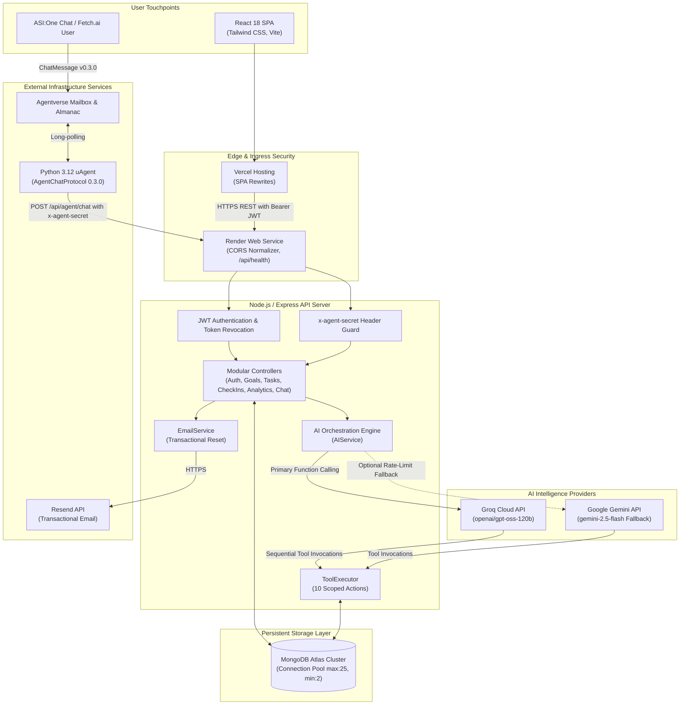

<div align="center">

# HabitHero

<p align="center">
  <strong>Don't just set goals. Actually achieve them.</strong>
</p>

<p align="center">
  <a href="LICENSE"></a>
  <a href="https://www.typescriptlang.org/"></a>
  <a href="https://nodejs.org/"></a>
  <a href="https://reactjs.org/"></a>
  <a href="https://www.mongodb.com/"></a>
  <br />
  <a href="https://groq.com/"></a>
  <a href="https://fetch.ai/"></a>
  <a href="backend/tests/"></a>
  <a href="habithero-agent/tests/"></a>
</p>

<p align="center">
  HabitHero is an autonomous AI accountability companion and habit management platform.<br />
  It turns ambitious goals into structured 4-phase micro-commitments, tracks streak continuity using the<br />
  <em>"Never Miss Twice"</em> behavioral principle, autonomously recalibrates daily workload when life gets busy,<br />
  and interfaces directly with decentralized agent ecosystems via Fetch.ai and ASI:One.
</p>

</div>

---

## Table of Contents

- [Overview](#overview)
- [Key Features](#key-features)
- [System Architecture](#system-architecture)
- [Technology Stack](#technology-stack)
- [Repository Structure](#repository-structure)
- [Local Development Setup](#local-development-setup)
- [Environment Variables](#environment-variables)
- [API Documentation](#api-documentation)
- [AI Architecture & Tool Calling](#ai-architecture--tool-calling)
- [Fetch.ai uAgent & ASI:One](#fetchai-uagent--asione)
- [Automated Testing](#automated-testing)
- [Production Deployment Guide](#production-deployment-guide)
  - [Render (Backend Deployment)](#render-backend-deployment)
  - [Vercel (Frontend Deployment)](#vercel-frontend-deployment)
  - [Fetch.ai Agent Deployment](#fetchai-agent-deployment)
  - [Resend Email Domain Setup](#resend-email-domain-setup)
- [Security & Data Protection](#security--data-protection)
- [Roadmap](#roadmap)
- [License](#license)

---

## Overview

Most habit trackers act as passive logs: when life intervenes and a user misses a target, the application records a broken streak, triggering guilt and abandonment.

HabitHero functions as an active behavioral partner:
1. **Decomposes Ambition**: Translates a broad target into progressive milestone phases.
2. **Adapts Under Strain**: When energy is low or schedules conflict, the AI automatically rescales task duration (e.g. from 45 minutes down to 15 minutes) to protect the habit loop without breaking streak momentum.
3. **Dual Access**: Accessible through a React SaaS web application or via natural conversation on decentralized chat protocols through Fetch.ai and ASI:One.

---

## Key Features

- **4-Phase Habit Roadmaps**: Automatic milestone structuring across Foundation, Rhythm, Depth, and Automaticity phases.
- **Daily Action Feed & Focus Task**: Highlights today's primary commitment with completion toggles, optimistic updates, and completion timestamps.
- **Adaptive Workload Rescaling**: 10 autonomous backend AI tools dynamically calibrate upcoming tasks when a user records a check-in indicating difficulty or missed sessions.
- **Daily Check-In & Evening Reflection**: Guided check-in modal capturing execution quality (Great, Partial, Missed), energy levels, and reflection notes.
- **Rhythm Matrix & Consistency Analytics**: Visual monthly calendar alongside metrics tracking active streaks, overall consistency rate, category distribution, and bounce-back resilience.
- **Multi-Tenant User Isolation**: Strict user-scoped querying on all database operations; cross-tenant access attempts return HTTP 404 or 403.
- **Enterprise Account Security**: Password hashing with bcrypt, stateless JWT session tokens, and cryptographic password reset with 15-minute SHA-256 tokens and IP/User-Agent auditing via Resend.
- **Decentralized Agent Protocol**: Native Fetch.ai `AgentChatProtocol` v0.3.0 compliance with Agentverse mailbox support for ASI:One chat interaction.
- **Production-Hardened Infrastructure**: Active database health probes (`/api/health`), credential sanitization in all logs, connection pool optimization, and strict multi-origin CORS validation.

---

## System Architecture



---

## Technology Stack

| Domain | Technology | Version | Purpose |
| :--- | :--- | :--- | :--- |
| **Frontend** | React | `^18.3.1` | Single-page application UI |
| | TypeScript | `^5.6.3` | Type-safe component development |
| | Vite | `^5.4.9` | High-performance bundling and development server |
| | Tailwind CSS | `^3.4.14` | Design system styling and warm neutral design tokens |
| | React Router | `^7.18.5` | Public and authenticated layout routing and guards |
| | Lucide React | `^0.453.0` | Accessible iconography |
| **Backend** | Node.js | `>=20.0.0` | Server runtime environment |
| | Express | `^4.21.1` | REST API framework |
| | TypeScript | `^5.6.3` | Backend type definitions and NodeNext module compilation |
| | Mongoose | `^8.7.3` | MongoDB ODM with connection pooling and automated indexing |
| | Zod | `^3.23.8` | Schema validation on API requests |
| | jsonwebtoken | `^9.0.2` | Stateless HMAC-SHA256 bearer tokens |
| | bcryptjs | `^2.4.3` | Salting and hashing passwords (cost factor 10) |
| | Resend | `^6.37.0` | Transactional email delivery for password recovery |
| **AI Layer** | Groq SDK | `^1.6.0` | Primary LLM engine running `openai/gpt-oss-120b` |
| | Google GenAI | `^2.32.0` | Optional fallback provider running `gemini-2.5-flash` |
| **Agent Layer** | Python | `3.12` | Runtime for autonomous Fetch.ai agent |
| | uagents | `0.26.1` | Fetch.ai micro-agent framework |
| | uagents-core | `0.4.12` | Official `AgentChatProtocol` 0.3.0 specification |
| | aiohttp | `^3.9.0` | Async HTTP client communicating with Node.js backend |
| **Database** | MongoDB Atlas | `>=7.0` | Document database for multi-tenant habit storage |

---

## Repository Structure

```text
hero-habit/
├── backend/                             # Node.js & Express TypeScript Backend
│   ├── src/
│   │   ├── ai/                          # AI reasoning and tool calling engine
│   │   │   ├── providers/               # GroqProvider (primary) & GeminiProvider (fallback)
│   │   │   ├── aiService.ts             # Provider selector and message orchestrator
│   │   │   ├── prompts.ts               # Behavioral habit coaching system prompts
│   │   │   ├── toolDefinitions.ts       # 10 custom AI tool declarations
│   │   │   ├── toolExecutor.ts          # Tenant-isolated tool execution against MongoDB
│   │   │   └── types.ts                 # Provider and message interfaces
│   │   ├── config/                      # Infrastructure configuration
│   │   │   ├── db.ts                    # MongoDB connection, pooling, index sync & URI masking
│   │   │   └── envValidator.ts          # Production security environment validation
│   │   ├── controllers/                 # Route controllers (Auth, Goals, Tasks, CheckIns, Chat, Agent)
│   │   ├── middleware/                  # JWT auth, validation, rate limiting & quota guards
│   │   ├── models/                      # Mongoose models (User, Goal, Task, CheckIn, Message, Tokens)
│   │   ├── routes/                      # Express route endpoints
│   │   ├── schemas/                     # Zod request validation schemas
│   │   ├── services/                    # Domain business logic (Auth, Goals, Tasks, Email, Analytics)
│   │   ├── types/                       # Shared backend TypeScript types
│   │   ├── app.ts                       # Express application, CORS normalization & /api/health
│   │   └── server.ts                    # Production server entry point & graceful shutdown
│   ├── tests/                           # Integration test suites (141 automated tests)
│   ├── tsconfig.json                    # Backend TypeScript compiler settings (NodeNext)
│   └── package.json                     # Backend scripts and dependencies
│
├── frontend/                            # React 18, Vite & Tailwind CSS Client
│   ├── src/
│   │   ├── components/                  # UI components (Task cards, modals, navigation, banners)
│   │   ├── context/                     # AuthContext managing session state & profile updates
│   │   ├── layouts/                     # PublicLayout (marketing) and AppLayout (authenticated workspace)
│   │   ├── pages/
│   │   │   ├── public/                  # Landing, Login, Register, ForgotPassword, ResetPassword
│   │   │   └── app/                     # Dashboard, Habits, HabitDetail, NewHabit, Calendar, Analytics, Chat
│   │   ├── services/                    # ApiService executing API requests with token handling
│   │   ├── types/                       # Domain data types
│   │   ├── utils/                       # Milestone confetti triggers & helpers
│   │   ├── App.tsx                      # Master React Router v7 routes
│   │   └── main.tsx                     # React DOM entry point
│   ├── tailwind.config.js               # Theme configuration
│   ├── vite.config.ts                   # Vite bundler configuration
│   └── package.json                     # Frontend scripts and dependencies
│
├── habithero-agent/                     # Fetch.ai Autonomous Python uAgent
│   ├── tests/                           # Pytest test suite (10 automated agent tests)
│   ├── agent.py                         # uAgent definition, ChatProtocol 0.3.0 handlers & mailbox
│   ├── backend_client.py                # Async HTTP client forwarding messages to backend
│   ├── config.py                        # Python environment configuration
│   └── requirements.txt                 # Pinned dependencies (uagents 0.26.1)
│
├── docs/                                # Technical architecture and developer guides
│   ├── architecture.md                  # Detailed sequence diagrams and component specifications
│   └── development.md                   # Local setup notes
│
├── .env.example                         # Root environment template
├── .gitignore                           # Git ignore rules protecting all .env and secret files
├── LICENSE                              # MIT License
└── package.json                         # Workspace orchestrator package.json
```

---

## Local Development Setup

### Prerequisites

- **Node.js**: v20.0.0 or higher
- **npm**: v10.0.0 or higher
- **Python**: v3.12 (specifically required for `uagents 0.26.1`)
- **MongoDB**: A running local MongoDB instance on port 27017, or a free MongoDB Atlas cluster connection string. *(In development mode only, an in-memory database will automatically launch if local MongoDB is unavailable).*

### 1. Clone Repository & Install Dependencies

```powershell
# Clone repository
git clone https://github.com/manish23092003/habithero-agent.git
cd habithero-agent

# Install dependencies for both backend and frontend
npm run install:all
```

### 2. Configure Environment Files

Create the local environment files from their templates:

```powershell
# Backend
Copy-Item backend/.env.example backend/.env

# Fetch.ai Agent
Copy-Item habithero-agent/.env.example habithero-agent/.env
```

Edit `backend/.env` to configure your API keys (e.g., [Groq Console](https://console.groq.com/keys)).

### 3. Start Backend & Frontend

Open two terminal sessions:

```powershell
# Terminal 1: Backend API (runs on http://localhost:5000)
cd backend
npm run dev
```

```powershell
# Terminal 2: Frontend Web App (runs on http://localhost:5173)
cd frontend
npm run dev
```

Visit `http://localhost:5173` in your browser.

### 4. Start Fetch.ai uAgent (Optional for Local Web Development)

In a third terminal:

```powershell
cd habithero-agent

# Create virtual environment with Python 3.12
python -m venv .venv

# Activate virtual environment (Windows PowerShell)
.\.venv\Scripts\Activate.ps1

# Install pinned agent dependencies
pip install -r requirements.txt

# Start the uAgent (runs on http://localhost:8000)
python agent.py
```

---

## Environment Variables

All sensitive values must be kept in ignored environment files. Never commit `.env` files.

### Backend (`backend/.env`)

| Variable | Required | Description | Placeholder / Example |
| :--- | :---: | :--- | :--- |
| `NODE_ENV` | Yes | Runtime environment (`development`, `test`, `production`) | `development` |
| `PORT` | Yes | HTTP listening port | `5000` |
| `MONGODB_URI` | Yes | MongoDB Atlas connection string | `mongodb://localhost:27017/habithero` |
| `JWT_SECRET` | Yes | Cryptographic secret for signing tokens (min. 16 characters in production) | `your_jwt_secret_key_change_in_production` |
| `FRONTEND_URL` | Yes | Allowed CORS origin(s). Supports comma-separated origins. | `http://localhost:5173` |
| `AI_PROVIDER` | Yes | Selected primary AI provider (`groq` or `gemini`) | `groq` |
| `GROQ_API_KEY` | Yes* | Groq API key (Required if `AI_PROVIDER=groq`) | `your_groq_api_key_here` |
| `GROQ_MODEL` | No | Groq model identifier | `openai/gpt-oss-120b` |
| `GEMINI_API_KEY` | No | Google Gemini API key (Required if using Gemini provider or fallback) | `your_gemini_api_key_here` |
| `GEMINI_MODEL` | No | Gemini model identifier | `gemini-2.5-flash` |
| `ENABLE_GEMINI_FALLBACK` | No | Activate Gemini fallback if Groq encounters quota limits | `false` |
| `AGENT_SERVICE_SECRET` | Yes | Shared secret for Fetch.ai uAgent authentication (min. 16 chars) | `your_agent_service_secret_here` |
| `RESEND_API_KEY` | Optional | Resend API key for password reset delivery (starts with `re_`) | `re_your_resend_api_key_here` |
| `EMAIL_FROM` | Optional | Sender address (must match verified domain in Resend) | `HabitHero <recovery@yourdomain.com>` |
| `METRICS_SECRET` | Optional | Authorization key for `/api/metrics` monitoring endpoint | `your_secure_metrics_monitoring_secret_here` |
| `MONGO_MAX_POOL_SIZE` | No | Maximum socket connection pool size (defaults to `25`) | `25` |
| `MONGO_MIN_POOL_SIZE` | No | Minimum warm socket connection pool size (defaults to `2`) | `2` |

### Frontend (`frontend/.env` or Host Build Environment)

| Variable | Required | Description | Placeholder / Example |
| :--- | :---: | :--- | :--- |
| `VITE_API_URL` | Yes (in Prod) | Base API endpoint URL (baked at build time by Vite) | `https://api.yourdomain.com/api` |

### Fetch.ai uAgent (`habithero-agent/.env`)

| Variable | Required | Description | Placeholder / Example |
| :--- | :---: | :--- | :--- |
| `AGENT_NAME` | Yes | Display name for the agent | `HabitHero` |
| `AGENT_SEED_PHRASE` | Yes | Seed phrase for deterministic Fetch.ai address generation | `your_agent_recovery_seed_phrase_here` |
| `AGENT_PORT` | Yes | HTTP listening port for uAgent socket | `8000` |
| `BACKEND_API_URL` | Yes | Target endpoint forwarding chat messages to Express backend | `https://api.yourdomain.com/api/agent/chat` |
| `AGENT_SERVICE_SECRET` | Yes | Must match backend `AGENT_SERVICE_SECRET` | `your_agent_service_secret_here` |
| `AGENT_MAILBOX_KEY` | For ASI:One | Agentverse Mailbox API Key for live message receipt | `your_agentverse_mailbox_key_here` |

---

## API Documentation

All routes are prefixed with `/api`. Protected routes require a valid HTTP header: `Authorization: Bearer <token>`.

### System & Health

| Method | Endpoint | Auth | Description |
| :--- | :--- | :---: | :--- |
| `GET` | `/api/health` | None | Database-aware readiness check. Returns `200` with `database: "connected"` when MongoDB is ready; returns `503` with `database: "disconnected"` when degraded. |
| `GET` | `/api/metrics` | Header / JWT | System observability metrics (event-loop lag, memory, MongoDB socket pool stats). Requires `x-metrics-key` or admin JWT. |

### Authentication & Account Recovery (`/api/auth`)

| Method | Endpoint | Auth | Description |
| :--- | :--- | :---: | :--- |
| `POST` | `/api/auth/register` | None | Register account (`name`, `email`, `password`). Returns JWT and profile. |
| `POST` | `/api/auth/login` | None | Authenticate (`email`, `password`). Returns JWT and profile. |
| `POST` | `/api/auth/forgot-password` | None | Request password reset email. Rate-limited. Returns generic 200 to prevent account enumeration. |
| `POST` | `/api/auth/reset-password` | None | Complete password reset (`token`, `password`). Invalidates existing tokens and sessions. |
| `GET` | `/api/auth/me` | Bearer JWT | Retrieve current authenticated user profile. |
| `PATCH` | `/api/auth/me` | Bearer JWT | Update profile display name. |

### Habit Goals (`/api/goals`)

| Method | Endpoint | Auth | Description |
| :--- | :--- | :---: | :--- |
| `GET` | `/api/goals` | Bearer JWT | List all habit goals for the authenticated user. |
| `POST` | `/api/goals` | Bearer JWT | Create a new goal, auto-generate 4-phase plan, and schedule kickoff Day 1 task. |
| `GET` | `/api/goals/:id` | Bearer JWT | Retrieve specific goal details and associated milestone plan. |
| `PATCH` | `/api/goals/:id` | Bearer JWT | Update goal parameters (title, daily commitment, status). |
| `DELETE` | `/api/goals/:id` | Bearer JWT | Delete goal and cascade-delete all associated daily tasks. |

### Tasks (`/api/tasks`)

| Method | Endpoint | Auth | Description |
| :--- | :--- | :---: | :--- |
| `GET` | `/api/tasks` | Bearer JWT | List all scheduled tasks across active goals. |
| `GET` | `/api/tasks/today` | Bearer JWT | List tasks scheduled for today's date. |
| `POST` | `/api/tasks` | Bearer JWT | Manually create a task under a goal. |
| `PATCH` | `/api/tasks/:id/complete` | Bearer JWT | Toggle completion status, set `completedAt`, and update streak counter. |
| `PATCH` | `/api/tasks/:id` | Bearer JWT | Update task title, duration, or difficulty. |

### Check-Ins (`/api/checkins`)

| Method | Endpoint | Auth | Description |
| :--- | :--- | :---: | :--- |
| `GET` | `/api/checkins` | Bearer JWT | List historical check-in records. |
| `GET` | `/api/checkins/today` | Bearer JWT | Retrieve today's check-in record if submitted. |
| `POST` | `/api/checkins` | Bearer JWT | Record daily reflection (`status`, `notes`, `energyLevel`). |

### Analytics (`/api/analytics`)

| Method | Endpoint | Auth | Description |
| :--- | :--- | :---: | :--- |
| `GET` | `/api/analytics` | Bearer JWT | Calculate multi-tenant consistency score, streak longevity, 30-day rhythm, and category distribution. |

### AI Companion & Chat (`/api/chat`)

| Method | Endpoint | Auth | Description |
| :--- | :--- | :---: | :--- |
| `POST` | `/api/chat/message` | Bearer JWT | Submit message to AI coach. Executes tools and saves dialogue. |
| `GET` | `/api/chat/conversations` | Bearer JWT | List user conversation threads. |
| `GET` | `/api/chat/conversations/:id` | Bearer JWT | Retrieve message history for a specific conversation. |
| `DELETE` | `/api/chat/conversations/:id` | Bearer JWT | Delete a conversation thread. |

### Decentralized Agent Ingress (`/api/agent`)

| Method | Endpoint | Auth | Description |
| :--- | :--- | :---: | :--- |
| `POST` | `/api/agent/chat` | `x-agent-secret` | Internal service-to-service endpoint for the Python uAgent. Dispatches message through `AIService` and returns structured reply. |

---

## AI Architecture & Tool Calling

HabitHero's AI layer (`backend/src/ai/`) provides bidirectional reasoning: the model is not merely a conversational bot, but has direct tool access to manage the user's habit database.

### Implemented AI Tools

| Tool Name | Parameters | Purpose |
| :--- | :--- | :--- |
| `create_goal` | `title`, `category`, `dailyCommitmentMinutes`, `targetDays` | Creates goal in MongoDB and schedules Day 1 kickoff task. |
| `get_user_goals` | *(none)* | Queries active goals and completion status for user. |
| `update_goal` | `goalId`, `dailyCommitmentMinutes`, `status`, `adaptationNotice` | Modifies goal targets with adaptation logs. |
| `get_today_tasks` | *(none)* | Retrieves tasks assigned for the current calendar date. |
| `create_tasks` | `goalId`, `tasks` array | Inserts custom milestone tasks into a habit plan. |
| `complete_task` | `taskId`, `completed` | Marks task completed and increments active streak. |
| `adapt_task` | `taskId`, `newDurationMinutes`, `adaptationNote`, `difficulty` | Scales down a task to a 5–15 min micro-sprint when fatigued. |
| `adapt_habit_plan` | `goalId`, `reason`, `targetMinutes` | Bulk-adapts upcoming tasks to prevent burnout. |
| `record_checkin` | `status`, `missedReason`, `reflection`, `adaptTomorrow` | Saves reflection check-in to MongoDB. |
| `get_progress_summary` | *(none)* | Calculates overall consistency rate and streak totals. |

### Execution Strategy

- **Primary Provider**: Groq using `openai/gpt-oss-120b` via `groq-sdk`. Groq executes function calls sequentially (`parallel_tool_calls: false`) to ensure deterministic database state transitions.
- **Quota & Rate Limit Defense**: `backend/src/middleware/aiQuotaGuard.ts` enforces token burst limits. If Groq encounters rate limiting (`429`), the error surfaces a clear `Retry-After` suggestion to the user.
- **Optional Fallback**: When `ENABLE_GEMINI_FALLBACK=true`, requests encountering rate limits seamlessly divert to `gemini-2.5-flash` via `@google/genai`.

---

## Fetch.ai uAgent & ASI:One

HabitHero implements an autonomous Python micro-agent (`habithero-agent/`) that bridges the platform to the Fetch.ai decentralized agent network.

- **Protocol Specification**: Uses the official `AgentChatProtocol` **v0.3.0** (`proto:30a801ed3a83f9a0ff0a9f1e6fe958cb91da1fc2218b153df7b6cbf87bd33d62`).
- **Deterministic Identity**: Derived from `AGENT_SEED_PHRASE`, creating a permanent Fetch.ai address (`agent1qghes4...`).
- **Communication Flow**:
  1. A user messages the agent on [ASI:One](https://asi1.ai/chat).
  2. The message is buffered in the Agentverse mailbox.
  3. The local uAgent event loop receives the `ChatMessage` and immediately emits a `ChatAcknowledgement`.
  4. The uAgent forwards the message content over HTTP POST to `/api/agent/chat` on the backend, authenticated with `x-agent-secret`.
  5. The backend maps the sender's address to an isolated user document in MongoDB and dispatches the prompt through the AI tool engine.
  6. The structured response returns to the Python agent, which packages it into a `ChatMessage` and delivers it back across the decentralized protocol.

---

## Automated Testing

The codebase includes comprehensive integration test suites across the backend API, AI tools, multi-tenant isolation, password reset security, and the Python uAgent.

### Running Backend Tests (141 Tests)

```powershell
cd backend
npm test
```

Latest verified backend test breakdown:
- **API & CRUD Suite** (`tests/api.test.ts`): 46 passing
- **Agent Endpoint & Isolation Suite** (`tests/agent.test.ts`): 17 passing
- **Groq AI Tool Calling Suite** (`tests/groq.test.ts`): 45 passing
- **Multi-Tenant Analytics Suite** (`tests/analytics.test.ts`): 4 passing
- **Password Reset Security Suite** (`tests/passwordReset.test.ts`): 14 passing
- **Production Hardening Suite** (`tests/productionHardening.test.ts`): 15 passing
- **Total**: **141 passing, 0 failing**

### Running Python uAgent Tests (10 Tests)

```powershell
cd habithero-agent
.\.venv\Scripts\python -m pytest -v tests/test_agent.py
```
- **Total**: **10 passing, 0 failing**

---

## Production Deployment Guide

### Render (Backend Deployment)

The backend is configured for deployment as a **Render Web Service**.

1. **Create Web Service**:
   - Connect your GitHub repository: `https://github.com/manish23092003/habithero-agent`
   - Select **Web Service**
2. **Build & Runtime Configuration**:
   - **Root Directory**: `backend`
   - **Environment**: `Node`
   - **Build Command**: `npm install && npm run build`
   - **Start Command**: `npm start`
   - **Health Check Path**: `/api/health`
3. **Environment Variables on Render**:
   - `NODE_ENV`: `production`
   - `PORT`: `10000` *(Render sets this automatically; backend binds to `0.0.0.0:${PORT}`)*
   - `MONGODB_URI`: `mongodb+srv://<user>:<password>@<cluster>.mongodb.net/habithero?retryWrites=true&w=majority`
   - `JWT_SECRET`: *(Cryptographically random string, minimum 16 characters)*
   - `FRONTEND_URL`: `https://your-frontend.vercel.app` *(Supports multiple comma-separated URLs; trailing slashes are safely normalized)*
   - `AI_PROVIDER`: `groq`
   - `GROQ_API_KEY`: *(Your production Groq API key)*
   - `GROQ_MODEL`: `openai/gpt-oss-120b`
   - `AGENT_SERVICE_SECRET`: *(Shared random secret, minimum 16 characters)*
   - `RESEND_API_KEY`: *(Optional for staging, required for password reset emails; starts with `re_`)*
   - `EMAIL_FROM`: `HabitHero <recovery@yourverifieddomain.com>`
   - `METRICS_SECRET`: *(Random secret protecting `/api/metrics`)*
   - `MONGO_MAX_POOL_SIZE`: `25`
   - `MONGO_MIN_POOL_SIZE`: `2`

### Vercel (Frontend Deployment)

The frontend is a static React single-page application built with Vite.

1. **Import Project into Vercel**:
   - **Root Directory**: `frontend`
   - **Framework Preset**: `Vite`
   - **Build Command**: `npm run build` (`tsc && vite build`)
   - **Output Directory**: `dist`
2. **Build Environment Variable**:
   - `VITE_API_URL`: `https://<your-render-service-name>.onrender.com/api`
   > [!IMPORTANT]
   > `VITE_API_URL` is baked into the JavaScript bundle at build time. Ensure this is configured in Vercel before initiating the production build.
3. **SPA Rewrites**:
   Ensure `vercel.json` in `frontend/` (or Vercel project settings) redirects all routes to `/index.html` to support client-side routing.

### Fetch.ai Agent Deployment

> [!WARNING]
> The Fetch.ai Python uAgent **cannot run on serverless platforms** (e.g., Vercel Functions, AWS Lambda). It runs an active, stateful asynchronous event loop (`agent.run()`) maintaining an open socket connection to Agentverse.

- **Hosting Requirement**: Deploy on an always-on container or background worker (e.g., Render Background Worker, Railway, Fly.io, or VPS).
- **Runtime**: Python 3.12 with `pip install -r requirements.txt`.
- **Start Command**: `python agent.py`
- **Required Environment Variables**:
  - `AGENT_NAME`: `HabitHero`
  - `AGENT_SEED_PHRASE`: *(Dedicated random production seed phrase)*
  - `AGENT_PORT`: `8000`
  - `BACKEND_API_URL`: `https://<your-render-service-name>.onrender.com/api/agent/chat`
  - `AGENT_SERVICE_SECRET`: *(Must exactly match backend `AGENT_SERVICE_SECRET`)*
  - `AGENT_MAILBOX_KEY`: *(Obtained from [agentverse.ai](https://agentverse.ai))*

### Resend Email Domain Setup

- **Sandbox Restriction**: By default, an unverified Resend account using `onboarding@resend.dev` can only deliver emails to the email address of the account owner.
- **Production Verification**: Before launching public password reset functionality:
  1. Add your custom domain in the [Resend Domains Dashboard](https://resend.com/domains).
  2. Configure the required DNS records (SPF, DKIM, and DMARC) with your domain registrar.
  3. Set `EMAIL_FROM=HabitHero <recovery@yourverifieddomain.com>` in your backend environment.

---

## Security & Data Protection

- **No Credential Logging**: All database connection strings are masked via `sanitizeMongoUri()` prior to logging. Usernames and passwords never appear in console logs, server outputs, or exception objects.
- **Zero Fallback in Production**: When `NODE_ENV=production`, `backend/src/config/db.ts` rejects any fallback to local or in-memory databases. If the Atlas connection fails, the process exits with code 1.
- **Multi-Tenant Scoping**: All mutations and queries filter by the authenticated token's `userId`. Users cannot view or modify foreign goals, tasks, check-ins, or chat sessions.
- **Timing-Attack Defense**: Password reset requests use PBKDF2 hashing when an unknown email is submitted, equalizing response timing and preventing user enumeration.
- **Error Masking**: Production errors on HTTP 500 return generic status messages without leaking database schemas or stack traces.
- **Git Protection**: Git ignore policies explicitly exclude `.env`, `.env.production`, `.env.staging`, `*.agent.key`, and database files.

---

## Roadmap

- [x] Full-Stack SaaS architecture (React 18 + Node.js Express + MongoDB)
- [x] 4-Phase Habit Roadmap generation and milestone tracking
- [x] Rhythm Calendar and Consistency Analytics matrix
- [x] Groq AI tool execution engine (10 autonomous tools)
- [x] Fetch.ai `AgentChatProtocol` 0.3.0 and Agentverse Mailbox integration
- [x] Production hardening: database readiness probes, URI masking, connection pooling
- [ ] Push notifications and scheduled evening check-in reminders
- [ ] Two-way synchronization with Google Calendar and Apple Calendar
- [ ] Social accountability circles with selective progress sharing

---

## License

This project is open-source and licensed under the terms of the [MIT License](LICENSE).

---

## Author

**Manish Soni**
- GitHub: [@manish23092003](https://github.com/manish23092003)
- Repository: [habithero-agent](https://github.com/manish23092003/habithero-agent)
