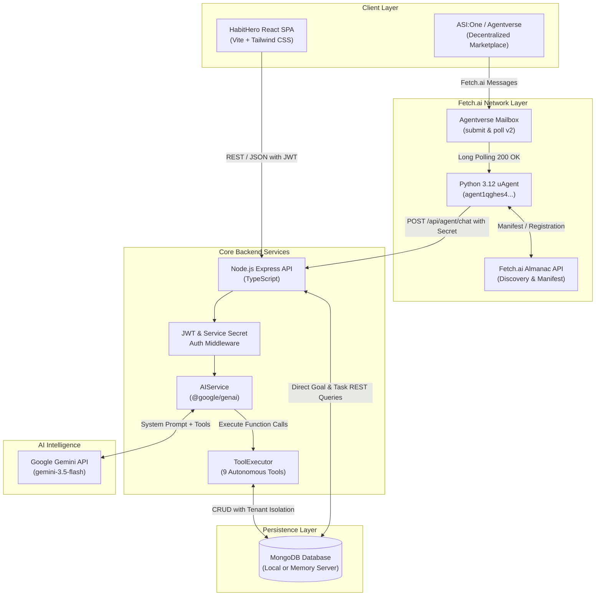
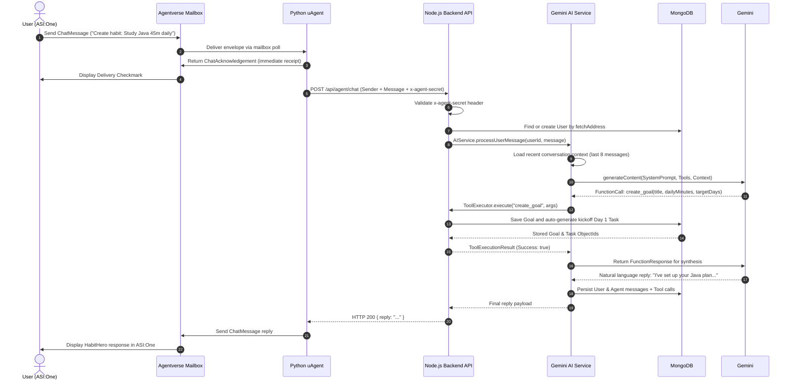
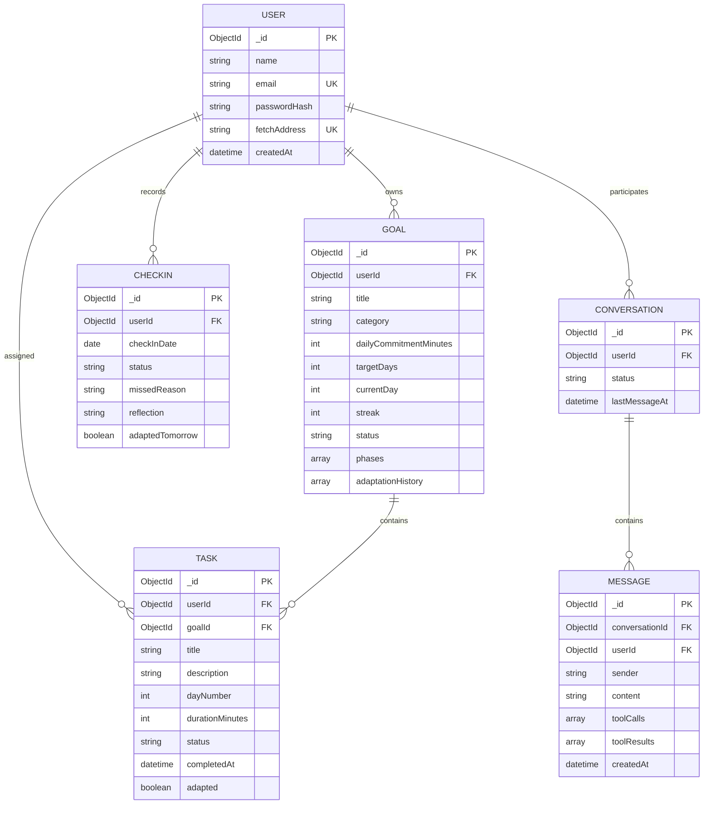

# HabitHero System Architecture

HabitHero is an autonomous AI accountability companion engineered to solve the consistency problem in personal development. This document details the technical architecture, data pipelines, conversational protocols, and multi-tenant security model.

---

## 1. High-Level Architecture Overview

HabitHero implements a **dual-entry unified backend architecture**. Users can interact with HabitHero through:
1. **Direct Web Application**: High-performance React 18 SPA with responsive dashboards, real-time streak trackers, and an embedded companion chat drawer.
2. **Decentralized Agentverse / ASI:One**: Conversational interface powered by a Python 3.12 Fetch.ai uAgent implementing `AgentChatProtocol` v0.3.0.

Both channels converge on the same Node.js & TypeScript backend, ensuring unified business logic, MongoDB persistence, and Gemini AI reasoning.

---

## 2. Dual-Entry Message Flow Sequence

### A. Web Application Flow
1. User logs in via `/api/auth/login` and receives a cryptographically signed JWT.
2. User submits a goal or opens the companion drawer to chat.
3. Express controller validates JWT claims (`req.user.id`).
4. Controller routes message to `AIService.processUserMessage()`.

### B. ASI:One / Fetch.ai Agentverse Flow
1. User interacts with HabitHero on the ASI:One agent chat portal.
2. Agentverse delivers `ChatMessage` to HabitHero's mailbox.
3. HabitHero uAgent daemon receives message and immediately sends `ChatAcknowledgement`.
4. uAgent securely forwards message to backend `POST /api/agent/chat` along with `x-agent-secret`.
5. Backend verifies secret, locates or automatically provisions an isolated user mapped to the Fetch.ai sender address (`agent1q...`), and passes request to `AIService`.

---

## 3. Database Entity Relationship (ER) Model

All entities enforce strict multi-tenant isolation through indexed `userId` references.

---

## 4. Autonomous Gemini AI Tool Engine

HabitHero defines **9 native tool declarations** provided to Gemini during each conversation turn. The model decides autonomously when to query or modify user state:

| Tool Name | Parameters | Responsibility |
|---|---|---|
| `create_goal` | `title`, `category`, `dailyCommitmentMinutes`, `targetDays` | Creates a new habit goal and automatically schedules the Day 1 kickoff task. |
| `get_today_tasks` | *(none)* | Queries all active, pending, or completed tasks for the current day. |
| `complete_task` | `taskId` | Marks a task as completed, timestamps it, and increments the goal streak. |
| `create_tasks` | `goalId`, `tasks: [{ title, durationMinutes, dayNumber }]` | Adds milestone or challenge micro-tasks to an existing goal. |
| `adapt_task` | `taskId`, `newDurationMinutes`, `adaptationNote` | Dynamically scales task duration down (e.g. 15m) when the user is busy. |
| `update_goal` | `goalId`, `dailyCommitmentMinutes`, `adaptationNotice` | Modifies the target commitment and logs adaptation reason in history. |
| `adapt_habit_plan` | `goalId`, `reason`, `targetMinutes` | Bulk adapts upcoming pending tasks to maintain momentum without burnout. |
| `record_checkin` | `status`, `missedReason`, `reflection`, `adaptTomorrow` | Records evening accountability check-in and triggers plan adjustments. |
| `get_progress_summary` | *(none)* | Computes overall consistency rate, current streak, and completion metrics. |

---

## 5. Security & Isolation Architecture

* **Tenant Segregation**: `req.user.id` is derived strictly from verified JWT tokens on REST endpoints, and from verified `fetchAddress` mapping on agent endpoints. No client can pass a foreign `userId` to mutate another user's goals or tasks.
* **Secret Protection**: API keys, JWT secrets, and database credentials exist exclusively in server-side environment variables and are never bundled in frontend code.
* **Service Secret Gate**: External requests to `/api/agent/chat` must supply the pre-shared `x-agent-secret` header, preventing unauthorized proxying into the agent processing pipeline.
